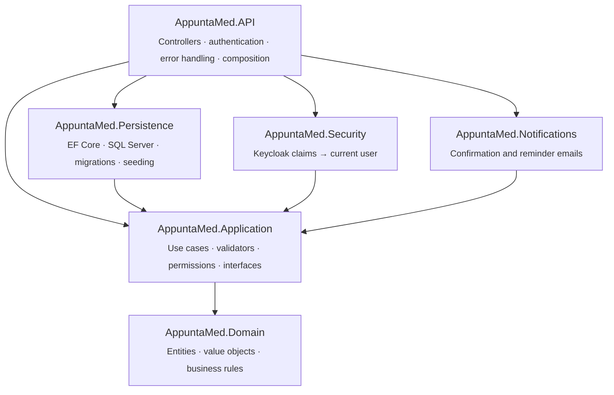
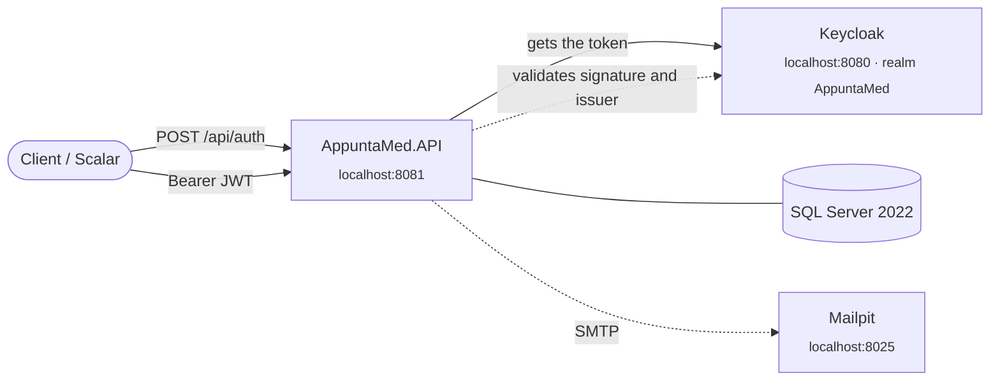
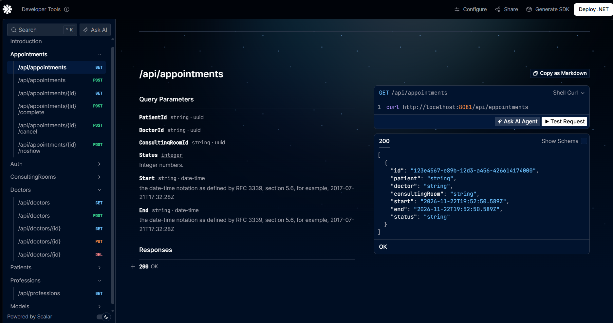
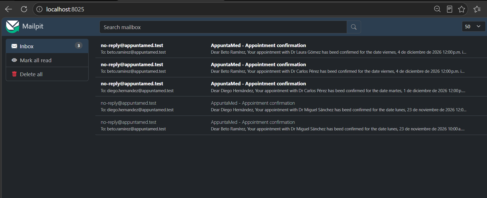
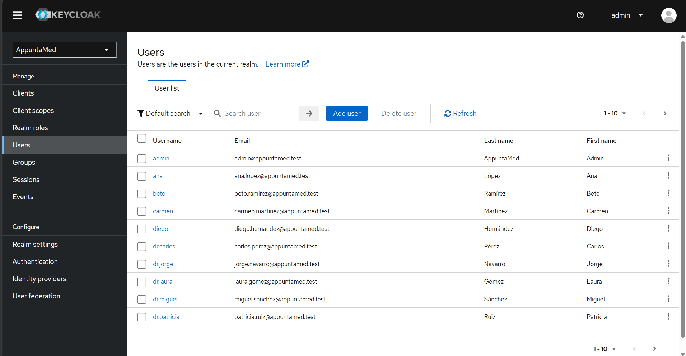
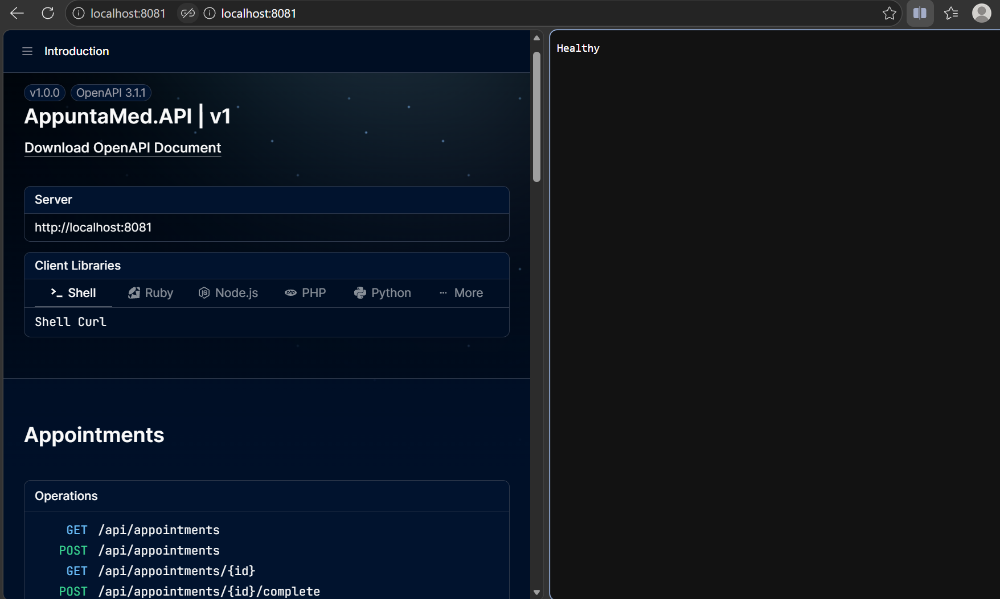

🇪🇸 [Español](README.md)&nbsp;|&nbsp;🇬🇧 English

# AppuntaMed — Medical Appointments API with Clean Architecture in .NET

A REST API to manage a clinic's schedule (doctors, patients, consulting rooms and appointments) built with **.NET 10**, **Clean Architecture** and **security delegated to Keycloak**. It started from a Clean Architecture course, but it did not stop there: I replaced the identity and authorization model, adapted the domain and added infrastructure, tests and CI until it worked end to end.

[](https://github.com/iliana212/AppuntaMed/actions/workflows/ci.yml)     

## At a glance

- 6 code projects organized by **Clean Architecture**: the domain depends on nothing and every dependency points inwards
- Authentication with **Keycloak** (OpenID Connect / JWT) and **permission-based** authorization derived from the realm roles (`Admin`, `Doctor`, `Patient`), plus **ownership** rules: a patient only sees and changes their own data
- Appointment scheduling with states and business rules (no time conflicts for the same doctor, no appointments in the past), a confirmation email and daily reminders
- A related catalog of professions and specialities (5 professions and 19 specialities): a speciality always belongs to the doctor's profession, also guaranteed by the database
- The whole system spins up with one command: `docker compose up -d --build` (API, SQL Server, Keycloak and Mailpit), with demo data and ready-to-use users
- More than 400 tests, including integration tests against a real SQL Server, and CI on GitHub Actions

## Architecture

Every arrow means "depends on":



And this is how it runs with Docker Compose:



The domain (`Domain`) knows neither EF Core nor ASP.NET; the application layer (`Application`) defines the interfaces (repositories, current user, notifications) and Persistence, Security and Notifications implement them. The API only wires everything together.

## Projects

| Project | Responsibility |
|---|---|
| **AppuntaMed.Domain** | Entities (`Appointment`, `Doctor`, `Patient`, `ConsultingRoom`, `Profession`, `Speciality`), value objects (`Email`, `PhoneNumber`, `TimeInterval`) and their invariants |
| **AppuntaMed.Application** | One use case per folder (command/query, validator and handler), a custom mediator, permissions per role and ownership rules |
| **AppuntaMed.Persistence** | EF Core with SQL Server, repositories, unit of work, migrations, the initial catalog and demo-data *seeding* |
| **AppuntaMed.Security** | Translates the Keycloak token claims into the current user (id, roles) |
| **AppuntaMed.Notifications** | Appointment confirmation email and reminders |
| **AppuntaMed.API** | Controllers, JWT authentication, authorization policies, global error handling, the reminder job and the *health check* |
| **AppuntaMed.Tests** | Unit and integration tests |

## Roles and permissions

Roles live in Keycloak (realm `AppuntaMed`); the API turns them into **permissions** and every endpoint requires one. On top of that, the use cases check that the user only touches **their own** data.

| Role | What it can do |
|---|---|
| **Admin** | Everything: manage doctors, patients, consulting rooms and any appointment |
| **Doctor** | View and list their appointments, complete them, cancel them or mark them as "no-show"; list patients; create and update their profile |
| **Patient** | Create and cancel **their** appointments, view and update **their** profile; browse doctors and professions |

## API

| Resource | Endpoints |
|---|---|
| **Appointments** `/api/appointments` | `GET` (list by date range) · `GET /{id}` · `POST` · `POST /{id}/cancel` · `/complete` · `/noshow` |
| **Doctors** `/api/doctors` | `GET` (filters by name, profession and speciality; paged) · `GET /{id}` · `POST` · `PUT /{id}` · `DELETE /{id}` |
| **Patients** `/api/patients` | `GET` (paged) · `GET /{id}` · `POST` · `PUT /{id}` · `DELETE /{id}` |
| **Professions** `/api/professions` | `GET` (catalog with its specialities) |
| **Consulting rooms** `/api/consultingrooms` | CRUD (`Admin` only) |
| **Auth** `/api/auth` | `POST` login and `POST /refresh` (password flow, meant for development) |
| **Health** `/health` | Anonymous; used by Docker |

Application errors are returned as `application/problem+json` with the right status (`400` validation or business rule, `403` ownership, `404` missing resource); the `401` and `403` for a missing token or permission are produced by authentication and authorization. The doctors and patients lists accept `page` (≥ 1) and `pageSize` (1 to 100) and return the total (with the filters applied) in the `total-items` header.

## Architecture & engineering decisions

Beyond the "what" was built, this is the "why" behind the key decisions:

- **Clean Architecture with the dependency rule actually enforced** — the domain references no other project; the application layer depends only on the domain and exposes interfaces that the infrastructure implements.
- **A rich domain, not a bag of properties** — entities validate their invariants in the constructor and expose named operations (`CancelAppointment`, `UpdateSpecialization`...) with private setters; `Email`, `PhoneNumber` and `TimeInterval` are value objects mapped as EF Core `ComplexProperty`.
- **Use cases with a custom mediator and FluentValidation** — each use case is a command or query with its validator and its handler; validators run before the handler and their errors come back as a `400` with the full list.
- **Keycloak instead of ASP.NET Identity** — the API stores no passwords and issues no tokens: it validates the JWT (signature, issuer and audience) and reads the roles from the realm claim.
- **Two-level authorization** — (1) permissions: one policy per permission, registered by walking the permission list so one can never be forgotten; (2) ownership: the use case checks that a patient or doctor only reaches **their own** resources, so changing an `id` in the URL does not expose someone else's data.
- **Global error handling** — an `IExceptionHandler` maps domain and application exceptions to `404`, `403` or `400` in `problem+json` format; unexpected errors return a generic message (`500`) without leaking internal details.
- **Medical history is never cascade-deleted** — the appointment foreign keys are `Restrict` and the use cases refuse to delete a doctor, patient or consulting room that has appointments, with an explanatory `400` instead of a database exception.
- **Integrity guaranteed by the database, not just by code** — a doctor's speciality is linked with a **composite foreign key** `(ProfessionId, SpecialityId)`: not even a manual `UPDATE` can assign a speciality from another profession (and with a null speciality the constraint does not apply, for general practitioners).
- **Two different mechanisms for initial data** — the profession and speciality catalog is *reference data* and ships with the migrations (`HasData`, fixed ids); demo data is optional (`Seeding:DemoData`) and its *seeder* is idempotent: it can run as many times as needed without duplicating anything.
- **Demo ids tied to Keycloak** — the `UserId` of every seeded doctor and patient is the `sub` of their realm user, so logging in as `ana` makes the API recognize her as the patient Ana; a test verifies that the code and the realm JSON never drift apart.
- **Resilient reminders** — a background job sends the next day's appointment reminders every day at 8:00, in a configurable time zone (`Reminders:TimeZoneId`); a failure sending an email is logged and does not stop the application.
- **Full containerization** — a multi-stage `Dockerfile` with an unprivileged user, SQL Server with a *healthcheck*, Keycloak with the realm imported automatically, Mailpit to see the emails, and migrations and seeding on startup. Keycloak is configured so the token issuer (`localhost:8080`) and the internal route between containers (`keycloak:8080`) can coexist.
- **Integration tests against a real SQL Server** — `WebApplicationFactory` plus Testcontainers run the whole API with real migrations and seeding; only authentication (headers that emit the same claims Keycloak does, so the real policies and ownership rules run) and email (recorded instead of sent) are replaced. Tests never modify the demo data: they create their own, in unique time slots.
- **Tests that watch the configuration** — they check that the Docker port matches the Keycloak client, that `.env.example` documents every variable, that the .NET version is the same across projects, Dockerfile and pipeline, and that no test reads a git-ignored file.
- **Continuous integration with GitHub Actions** — on every push and pull request it builds, runs the unit and integration tests with coverage, brings up the whole stack with Docker Compose and runs a smoke test (login, a token the API accepts across containers, seeded data). CodeQL scans the code weekly and on every pull request, and Dependabot keeps dependencies up to date without jumping to new major .NET versions.
- **Secrets kept out of version control** — passwords parameterized through `.env` (only `.env.example` is versioned); the realm passwords are **for development only**.

## Tech stack

`.NET 10` · `ASP.NET Core` · `Entity Framework Core` · `SQL Server` · `Keycloak (OpenID Connect / JWT)` · `FluentValidation` · `Scrutor` · `Scalar / OpenAPI` · `xUnit` · `NSubstitute` · `Testcontainers` · `coverlet` · `Docker` / `Docker Compose` · `Mailpit` · `GitHub Actions` · `CodeQL` · `Dependabot`

## Running it locally

Requirement: Docker.

```bash
git clone https://github.com/iliana212/AppuntaMed.git
cd AppuntaMed

cp .env.example .env   # set MSSQL_SA_PASSWORD (without ";") and the Keycloak admin password

docker compose up -d --build
```

The first time, the images are downloaded and the API takes a moment to be ready: it applies the migrations and loads the demo data (doctors, patients, consulting rooms and appointments) on startup.

| Service | URL |
|---|---|
| API + documentation (Scalar) | http://localhost:8081/scalar |
| Keycloak (administration) | http://localhost:8080 |
| Mailpit (sent emails) | http://localhost:8025 |
| Health check | http://localhost:8081/health |

**Demo users** (imported from `keycloak/realm-appuntamed.json`; for development only):

| User | Role | Password |
|---|---|---|
| `admin` | Admin | `Admin123!` |
| `dr.carlos` · `dr.laura` · `dr.miguel` · `dr.patricia` · `dr.jorge` | Doctor | `Doctor123!` |
| `ana` · `beto` · `carmen` · `diego` · `elena` | Patient | `Patient123!` |

**Try it out:**

```bash
# 1. Log in as the patient Ana and keep the token
TOKEN=$(curl -s -X POST http://localhost:8081/api/auth \
  -H "Content-Type: application/json" \
  -d '{"user":"ana","psswd":"Patient123!"}' | jq -r .access_token)

# 2. Read the catalog (any role can)
curl -H "Authorization: Bearer $TOKEN" http://localhost:8081/api/professions

# 3. Without a token: 401
curl -i http://localhost:8081/api/professions
```

In Scalar (`/scalar`) add the `Authorization: Bearer <token>` header to the request. To see ownership-based authorization, use Ana's token to ask for another patient's profile: the API answers `403`. If you create an appointment as a patient, the confirmation email shows up in Mailpit.

To check that the whole stack works end to end: `bash scripts/smoke-test.sh` (needs `curl` and `jq`). To start from scratch (database, realm and emails): `docker compose down -v`.

**Debugging from the IDE:** start only the infrastructure (`docker compose up -d sqlserver keycloak`) and set, with `dotnet user-secrets`, the connection string (`ConnectionStrings:AppuntaMedSqlServer`) and the `Authentication` section (`Authority`, `Audience`, `RequireHttpsMetadata`) of the `AppuntaMed.API` project. Apply the migrations with `dotnet ef database update --project AppuntaMed.Persistence --startup-project AppuntaMed.API` (with `Seeding:DemoData=true` it also loads the demo data). Booking an appointment sends an email: without the `CONFIG_EMAIL` section it would fail, so for that part the full Docker stack with Mailpit is the better choice.

## Tests

```bash
dotnet test                                    # all of them (requires Docker)
dotnet test --filter "Category!=Integration"   # unit only, no Docker
dotnet test --filter "Category=Integration"    # integration only
```

| Level | What it covers |
|---|---|
| **Unit** | Entities and value objects; use cases with mocked repositories (including ownership rules and failures); validators and their limits; permissions per role; HTTP error handling; claims transformation; the reminders' time zone; and configuration consistency (Docker, Keycloak, CI) |
| **Integration** | The whole API on a real SQL Server (real migrations and seeding): normal cases, edge cases (back-to-back appointments, date ranges, paging), failures (`400`, `401`, `403`, `404`) and ownership; EF queries (appointment overlap, filters and ordering); database constraints (no cascade, composite foreign key, unique indexes); and the seeder's idempotency |


## Screenshots

| Scalar — API documentation | Confirmation email in Mailpit |
|---|---|
|  |  |

| Keycloak realm | Health Check |
|---|---|
|  |  |
