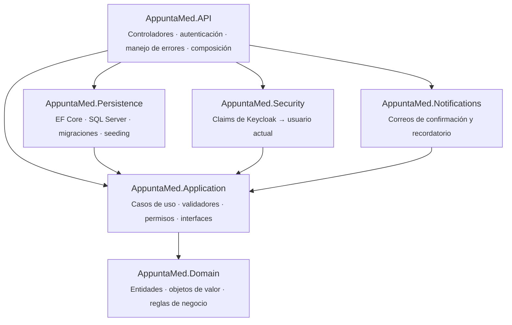
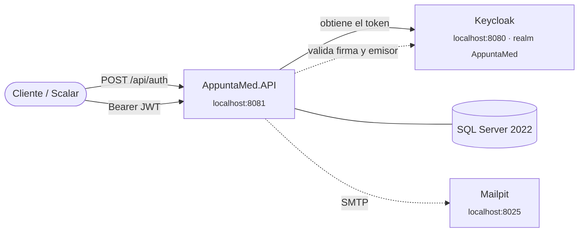
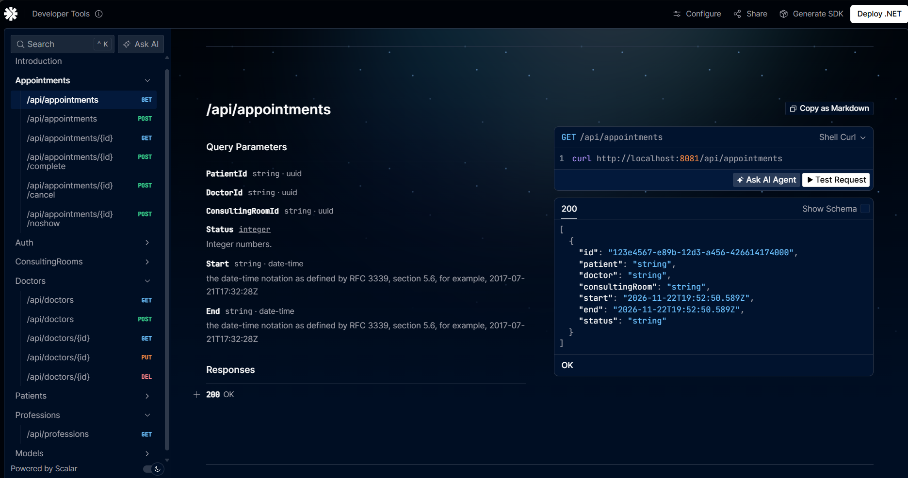
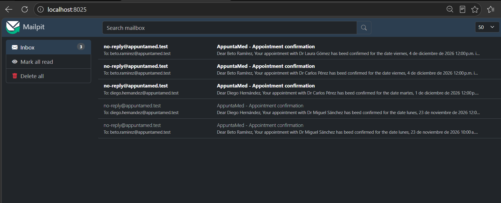
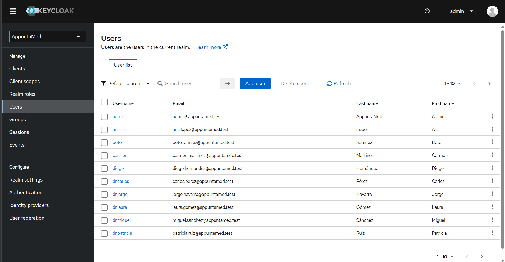
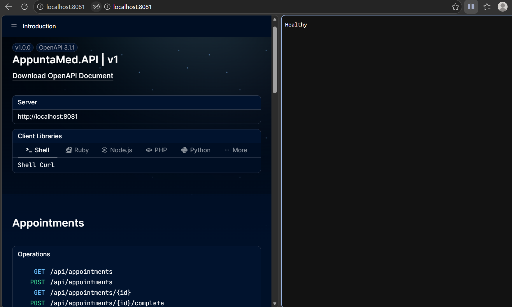

🇪🇸 Español&nbsp;|&nbsp;🇬🇧 [English](README.en.md)

# AppuntaMed — API de Citas Médicas con Arquitectura Limpia en .NET

API REST para gestionar la agenda de una clínica (doctores, pacientes, consultorios y citas) construida con **.NET 10**, **Arquitectura Limpia** y la **seguridad delegada en Keycloak**. Nació de un curso de Arquitectura Limpia, pero no se quedó en el curso: cambié el modelo de identidad y de autorización, adapté el dominio y le sumé infraestructura, pruebas y CI hasta dejarlo funcionando de punta a punta.

[](https://github.com/iliana212/AppuntaMed/actions/workflows/ci.yml)     

## En un vistazo

- 6 proyectos de código organizados por **Arquitectura Limpia**: el dominio no depende de nada y todas las dependencias apuntan hacia adentro
- Autenticación con **Keycloak** (OpenID Connect / JWT) y autorización **por permisos** derivados de los roles del realm (`Admin`, `Doctor`, `Patient`), más reglas de **propiedad**: un paciente solo ve y modifica lo suyo
- Agenda de citas con estados y reglas de negocio (sin choques de horario para un mismo doctor, sin citas en el pasado), correo de confirmación y recordatorios diarios
- Catálogo relacionado de profesiones y especialidades (5 profesiones y 19 especialidades): una especialidad siempre pertenece a la profesión del doctor, garantizado también por la base de datos
- Todo el sistema se levanta con un solo comando: `docker compose up -d --build` (API, SQL Server, Keycloak y Mailpit), con datos de demo y usuarios listos para probar
- Más de 400 pruebas, incluidas pruebas de integración contra un SQL Server real, y CI en GitHub Actions

## Arquitectura

Cada flecha significa "depende de":



Y así corre con Docker Compose:



El dominio (`Domain`) no conoce ni a EF Core ni a ASP.NET; la capa de aplicación (`Application`) define las interfaces (repositorios, usuario actual, notificaciones) y las implementan Persistence, Security y Notifications. La API solo compone todo.

## Proyectos

| Proyecto | Responsabilidad |
|---|---|
| **AppuntaMed.Domain** | Entidades (`Appointment`, `Doctor`, `Patient`, `ConsultingRoom`, `Profession`, `Speciality`), objetos de valor (`Email`, `PhoneNumber`, `TimeInterval`) y sus invariantes |
| **AppuntaMed.Application** | Un caso de uso por carpeta (comando/consulta, validador y handler), mediador propio, permisos por rol y reglas de propiedad |
| **AppuntaMed.Persistence** | EF Core con SQL Server, repositorios, unidad de trabajo, migraciones, catálogo inicial y *seeding* de datos de demo |
| **AppuntaMed.Security** | Traduce los claims del token de Keycloak al usuario actual (id, roles) |
| **AppuntaMed.Notifications** | Correo de confirmación de cita y recordatorios |
| **AppuntaMed.API** | Controladores, autenticación JWT, políticas de autorización, manejo global de errores, tarea de recordatorios y *health check* |
| **AppuntaMed.Tests** | Pruebas unitarias y de integración |

## Roles y permisos

Los roles viven en Keycloak (realm `AppuntaMed`); la API los convierte en **permisos** y cada endpoint exige uno. Además, en los casos de uso se verifica que el usuario solo toque **sus propios** datos.

| Rol | Qué puede hacer |
|---|---|
| **Admin** | Todo: gestionar doctores, pacientes, consultorios y cualquier cita |
| **Doctor** | Ver y listar sus citas, completarlas, cancelarlas o marcarlas como "no se presentó"; listar pacientes; crear y actualizar su perfil |
| **Patient** | Crear y cancelar **sus** citas, ver y actualizar **su** perfil; consultar doctores y profesiones |

## API

| Recurso | Endpoints |
|---|---|
| **Citas** `/api/appointments` | `GET` (lista por rango de fechas) · `GET /{id}` · `POST` · `POST /{id}/cancel` · `/complete` · `/noshow` |
| **Doctores** `/api/doctors` | `GET` (filtros por nombre, profesión y especialidad; paginado) · `GET /{id}` · `POST` · `PUT /{id}` · `DELETE /{id}` |
| **Pacientes** `/api/patients` | `GET` (paginado) · `GET /{id}` · `POST` · `PUT /{id}` · `DELETE /{id}` |
| **Profesiones** `/api/professions` | `GET` (catálogo con sus especialidades) |
| **Consultorios** `/api/consultingrooms` | CRUD (solo `Admin`) |
| **Auth** `/api/auth` | `POST` login y `POST /refresh` (flujo de contraseña, pensado para desarrollo) |
| **Salud** `/health` | Anónimo; lo usa Docker |

Los errores de la aplicación se devuelven como `application/problem+json` con el código correcto (`400` validación o regla de negocio, `403` propiedad, `404` recurso inexistente); los `401` y `403` por falta de token o de permiso los resuelve la autenticación y la autorización. Las listas de doctores y pacientes aceptan `page` (≥ 1) y `pageSize` (1 a 100) y devuelven el total (con los filtros aplicados) en el header `total-items`.


## Decisiones de arquitectura e ingeniería

- **Arquitectura Limpia con la regla de dependencias aplicada de verdad** — el dominio no referencia ningún otro proyecto; la capa de aplicación depende solo del dominio y expone interfaces que la infraestructura implementa.
- **Dominio rico, no un saco de propiedades** — las entidades validan sus invariantes en el constructor y exponen operaciones con nombre (`CancelAppointment`, `UpdateSpecialization`...) con setters privados; `Email`, `PhoneNumber` y `TimeInterval` son objetos de valor mapeados como `ComplexProperty` de EF Core.
- **Casos de uso con mediador propio y FluentValidation** — cada caso de uso es un comando o consulta con su validador y su handler; los validadores se ejecutan antes del handler y sus errores salen como un `400` con la lista completa.
- **Keycloak en lugar de ASP.NET Identity** — la API no guarda contraseñas ni emite tokens: valida el JWT (firma, emisor y audiencia) y toma los roles del claim del realm.
- **Autorización en dos niveles** — (1) permisos: una política por cada permiso, registradas recorriendo la lista de permisos para que no se pueda olvidar una; (2) propiedad: el caso de uso verifica que un paciente o doctor solo acceda a **sus** recursos, evitando que cambiar un `id` en la URL exponga datos ajenos.
- **Manejo global de errores** — un `IExceptionHandler` traduce las excepciones de dominio y de aplicación a `404`, `403` o `400` en formato `problem+json`; los errores inesperados devuelven un mensaje genérico (`500`) sin filtrar detalles internos.
- **El historial médico no se borra en cascada** — las claves foráneas de las citas son `Restrict` y los casos de uso rechazan borrar un doctor, paciente o consultorio con citas, con un `400` explicativo en vez de una excepción de base de datos.
- **Integridad garantizada por la base de datos, no solo por el código** — la especialidad de un doctor se enlaza con una **llave foránea compuesta** `(ProfessionId, SpecialityId)`: ni siquiera un `UPDATE` manual puede asignar una especialidad de otra profesión (y con especialidad nula la restricción no aplica, para los médicos generales).
- **Datos iniciales con dos mecanismos distintos** — el catálogo de profesiones y especialidades es *reference data* y viaja en las migraciones (`HasData`, con ids fijos); los datos de demo son opcionales (`Seeding:DemoData`) y su *seeder* es idempotente: se puede ejecutar cuantas veces haga falta sin duplicar nada.
- **Ids de demo ligados a Keycloak** — el `UserId` de cada doctor y paciente sembrado es el `sub` de su usuario en el realm, así que al iniciar sesión con `ana` el API la reconoce como la paciente Ana; una prueba verifica que el código y el JSON del realm no se desalineen.
- **Recordatorios resistentes** — una tarea en segundo plano envía cada día a las 8:00 los recordatorios de las citas del día siguiente, en una zona horaria configurable (`Reminders:TimeZoneId`); un error al enviar un correo se registra y no detiene la aplicación.
- **Contenerización completa** — `Dockerfile` multi-stage con usuario sin privilegios, SQL Server con *healthcheck*, Keycloak con el realm importado automáticamente, Mailpit para ver los correos, y migraciones y seeding al arrancar. Keycloak está configurado para que el emisor del token (`localhost:8080`) y la ruta interna entre contenedores (`keycloak:8080`) convivan.
- **Pruebas de integración contra un SQL Server real** — `WebApplicationFactory` más Testcontainers ejecutan la API completa con migraciones y seeding reales; solo se sustituyen la autenticación (cabeceras que emiten los mismos claims que Keycloak, así corren las políticas y reglas de propiedad reales) y el correo (se registra en lugar de enviarse). Las pruebas no modifican los datos de demo: crean los suyos en horarios únicos.
- **Pruebas que vigilan la configuración** — comprueban que el puerto de Docker coincide con el cliente de Keycloak, que `.env.example` documenta todas las variables, que la versión de .NET es la misma en proyectos, Dockerfile y pipeline, y que ninguna prueba lee archivos ignorados por git.
- **Integración continua con GitHub Actions** — en cada push y pull request compila, ejecuta las pruebas unitarias y de integración con cobertura, levanta todo el stack con Docker Compose y ejecuta una prueba de humo (login, token aceptado por la API entre contenedores, datos sembrados). CodeQL analiza el código cada semana y en cada pull request, y Dependabot mantiene las dependencias sin saltar a versiones mayores de .NET.
- **Secretos fuera del control de versiones** — contraseñas parametrizadas con `.env` (solo se versiona `.env.example`); las contraseñas del realm son **únicamente de desarrollo**.

## Stack técnico

`.NET 10` · `ASP.NET Core` · `Entity Framework Core` · `SQL Server` · `Keycloak (OpenID Connect / JWT)` · `FluentValidation` · `Scrutor` · `Scalar / OpenAPI` · `xUnit` · `NSubstitute` · `Testcontainers` · `coverlet` · `Docker` / `Docker Compose` · `Mailpit` · `GitHub Actions` · `CodeQL` · `Dependabot`

## Cómo correrlo localmente

Requisitos: Docker.

```bash
git clone https://github.com/iliana212/AppuntaMed.git
cd AppuntaMed

cp .env.example .env   # define MSSQL_SA_PASSWORD (sin ";") y la contraseña del admin de Keycloak

docker compose up -d --build
```

La primera vez se descargan las imágenes y el API tarda un poco en estar listo: aplica las migraciones y carga los datos de demo (doctores, pacientes, consultorios y citas) al arrancar.

| Servicio | URL |
|---|---|
| API + documentación (Scalar) | http://localhost:8081/scalar |
| Keycloak (administración) | http://localhost:8080 |
| Mailpit (correos enviados) | http://localhost:8025 |
| Health check | http://localhost:8081/health |

**Usuarios de demo** (importados desde `keycloak/realm-appuntamed.json`; solo para desarrollo):

| Usuario | Rol | Contraseña |
|---|---|---|
| `admin` | Admin | `Admin123!` |
| `dr.carlos` · `dr.laura` · `dr.miguel` · `dr.patricia` · `dr.jorge` | Doctor | `Doctor123!` |
| `ana` · `beto` · `carmen` · `diego` · `elena` | Patient | `Patient123!` |

**Probarlo:**

```bash
# 1. Iniciar sesión como la paciente Ana y guardar el token
TOKEN=$(curl -s -X POST http://localhost:8081/api/auth \
  -H "Content-Type: application/json" \
  -d '{"user":"ana","psswd":"Patient123!"}' | jq -r .access_token)

# 2. Consultar el catálogo (cualquier rol puede)
curl -H "Authorization: Bearer $TOKEN" http://localhost:8081/api/professions

# 3. Sin token: 401
curl -i http://localhost:8081/api/professions
```

En Scalar (`/scalar`) agrega el header `Authorization: Bearer <token>` a la petición. Para ver la autorización por propiedad, pide con el token de Ana el perfil de otro paciente: la API responde `403`. Si creas una cita como paciente, el correo de confirmación aparece en Mailpit.

Para comprobar que todo el stack funciona de punta a punta: `bash scripts/smoke-test.sh` (necesita `curl` y `jq`). Para empezar desde cero (base de datos, realm y correos): `docker compose down -v`.

**Depurar desde el IDE:** levanta solo la infraestructura (`docker compose up -d sqlserver keycloak`) y define con `dotnet user-secrets` la cadena de conexión (`ConnectionStrings:AppuntaMedSqlServer`) y la sección `Authentication` (`Authority`, `Audience`, `RequireHttpsMetadata`) del proyecto `AppuntaMed.API`. Aplica las migraciones con `dotnet ef database update --project AppuntaMed.Persistence --startup-project AppuntaMed.API` (con `Seeding:DemoData=true` también carga los datos de demo). Reservar una cita envía un correo: sin la sección `CONFIG_EMAIL` fallaría, por eso para esa parte conviene el stack completo de Docker con Mailpit.

## Pruebas

```bash
dotnet test                                    # todas (requiere Docker)
dotnet test --filter "Category!=Integration"   # solo unitarias, sin Docker
dotnet test --filter "Category=Integration"    # solo integración
```

| Nivel | Qué cubre |
|---|---|
| **Unitarias** | Entidades y objetos de valor; casos de uso con repositorios simulados (incluidas las reglas de propiedad y los fallos); validadores y sus límites; permisos por rol; manejo de errores HTTP; transformación de claims; zona horaria de los recordatorios; y la consistencia de la configuración (Docker, Keycloak, CI) |
| **Integración** | La API completa sobre SQL Server real (migraciones y seeding reales): casos normales, límites (citas contiguas, rangos de fechas, paginación), fallos (`400`, `401`, `403`, `404`) y propiedad; consultas de EF (solapamiento de citas, filtros y orden); restricciones de la base de datos (sin cascada, llave foránea compuesta, índices únicos); y la idempotencia del seeder |


## Capturas

| Scalar — documentación de la API | Correo de confirmación en Mailpit |
|---|---|
|  |  |

| Realm de Keycloak | Health Check |
|---|---|
|  |  |

